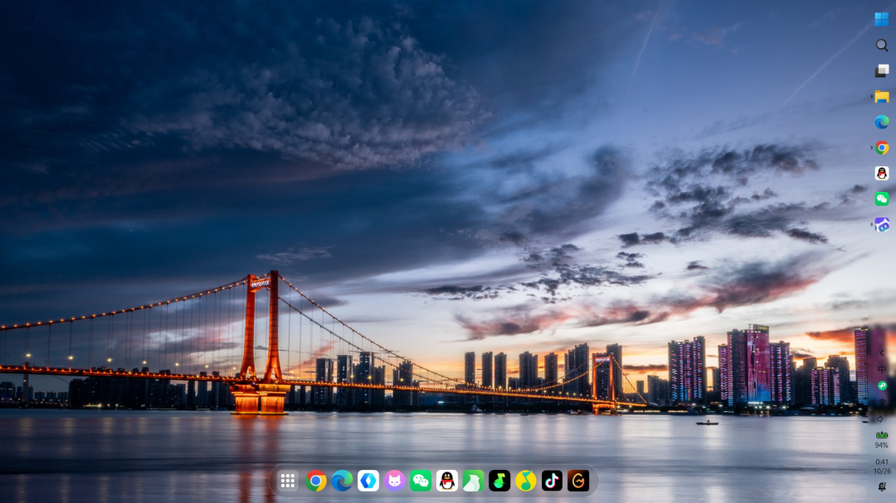
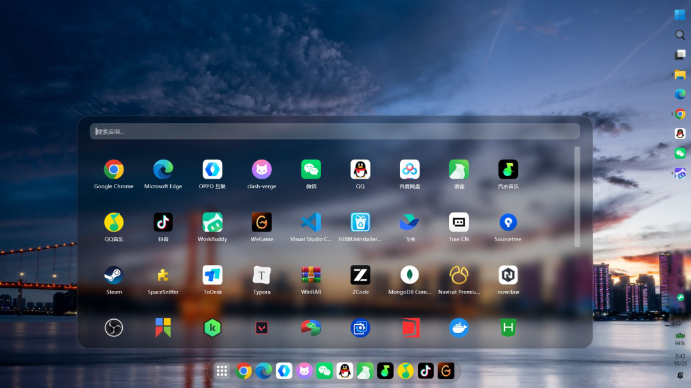
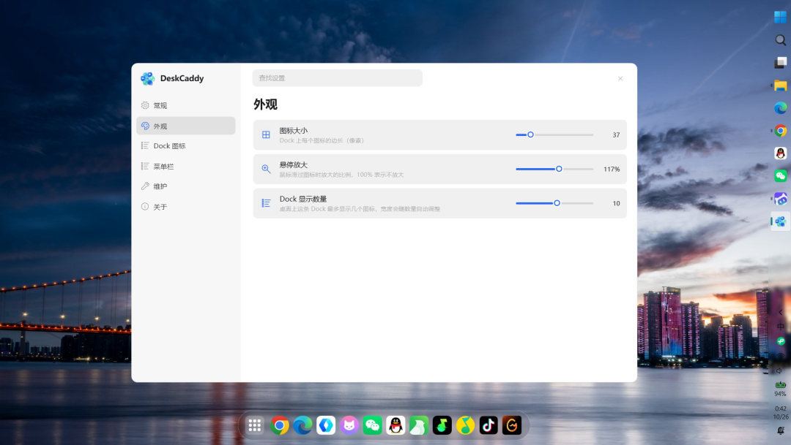

<div align="center">


# DeskCaddy

**一条 macOS 风格的玻璃 Dock，把你的 Windows 桌面真正清理干净。**

[](LICENSE)
[](#运行环境)
[](https://dotnet.microsoft.com/)
[](THIRD-PARTY-NOTICES.md)

[English](README.md) | 简体中文

</div>

---

DeskCaddy 会把你桌面上散落的快捷方式**真正移动**进一个托管收纳库，再以一条贴底的
毛玻璃 Dock 和一个 Launchpad 风格的菜单面板还给你。

与「隐藏桌面图标」类工具不同：被 DeskCaddy 收纳的快捷方式**物理离开桌面**（资源管理器
里也看不到）——而每一次移动都有流水账记录，随时可精确还原。

## 截图

**贴底的 Dock：**



**菜单栏面板（点击 Dock 最左侧的网格图标）：**

| 菜单栏 | 设置 |
|---|---|
|  |  |

## 功能

- **底部 Dock** —— 毛玻璃底（真实截屏 + 高斯模糊）、胶囊圆角、悬停轻微放大并带柔和光晕、单击启动
- **菜单栏面板** —— 全部收纳项的 Launchpad 式网格，即时搜索、回车启动、可选双击模式
- **原生右键菜单** —— 右键面板中的图标，弹出与资源管理器完全一致的菜单，包括已安装的 shell 扩展
- **双向拖放** —— 拖出到桌面或任意文件夹（真实移动）；Dock / 面板内拖拽排序；把快捷方式、
  文件、文件夹**拖到 Dock 上**即可收纳
- **安全内建** —— 每次移动都记录（来源路径 + SHA-256），支持单条或批量精确还原；
  移除一个「打不开」的快捷方式前会经过多层验证
- **设置控制台** —— 开机自启、图标大小、悬停放大、Dock 显示数量、菜单栏列数与图标大小、单击/双击模式
- **系统托盘** —— 打开菜单栏、打开设置、退出

## 运行环境

- Windows 11 22H2（build 22621）或更高，x64
- [.NET 10 桌面运行时](https://dotnet.microsoft.com/download/dotnet/10.0) ——
  或使用自包含构建（见[从源码构建](#从源码构建)）

## 安装

> 首个版本发布后，预构建产物会放在 [Releases](../../releases) 页面。目前请从源码构建。

1. 从 Releases 下载 `DeskCaddy.zip`，解压到任意位置
2. 运行 `DeskCaddy.exe`
3. 把桌面上的快捷方式拖到 Dock 上 —— 桌面立刻变干净

要把所有东西还原回桌面：托盘图标 → 设置 → **全部还原**。

## 工作原理

```
桌面快捷方式（.lnk）
        │  真实移动（同卷为重命名，瞬时完成）
        ▼
%LocalAppData%\DeskCaddy\collected\
        │  更新索引与流水账
        ▼
Dock / 菜单栏
```

安全模型：

- 程序以 `asInvoker` 运行，**永不请求管理员权限**
- 任何条目进入收纳库前都要过白名单闸门：拒绝重解析点（符号链接/联接）、系统文件、
  保留名（`desktop.ini`、`thumbs.db`），且必须直接位于桌面目录下
- 每次移动都追加到只增流水账（来源、目标、SHA-256、大小、时间）
- 删除一个「打不开」的快捷方式前要经过五层验证，即使全部通过也只是进入
  **隔离区**，而非直接删除
- **文件系统是唯一事实来源** —— 哪怕 DeskCaddy 明天消失了，每个快捷方式仍然好好躺在
  `collected\` 里，手工拖回去就行

## 数据位置

```
%LocalAppData%\DeskCaddy\
├── collected\      真实移动过来的快捷方式 / 文件 / 文件夹
├── state.json      索引（名称、来源、排序）
├── settings.json   界面设置
├── journal\        只增流水账（JSONL）
├── quarantine\     被移除的快捷方式先到这里，不做硬删除
├── cache\          提取出的图标缓存
└── logs\           应用日志
```

卸载或删除 DeskCaddy **不会触碰**这些文件。

## 命令行

程序自带 CLI，可脚本化使用（无需 UI）：

```powershell
cd src\DeskCaddy.Cli\bin\Release\net10.0-windows

.\DeskCaddy.Cli.exe scan                  # 只读扫描桌面
.\DeskCaddy.Cli.exe status                # 查看收纳库
.\DeskCaddy.Cli.exe collect <路径>        # 收纳单个条目（预演）
.\DeskCaddy.Cli.exe collect <路径> --apply
.\DeskCaddy.Cli.exe collect-all           # 批量收纳全部快捷方式（预演）
.\DeskCaddy.Cli.exe restore <名称> --apply
.\DeskCaddy.Cli.exe restore-all --apply
.\DeskCaddy.Cli.exe reconcile --apply     # 让索引与文件系统对齐
.\DeskCaddy.Cli.exe selftest 100          # 隔离环境端到端测试
```

所有破坏性操作**默认只预演**——不显式加 `--apply` 就不会有任何文件被移动。

## 从源码构建

- Windows 11 22H2+
- [.NET 10 SDK](https://dotnet.microsoft.com/download/dotnet/10.0)

```powershell
git clone https://github.com/<you>/DeskCaddy.git
cd DeskCaddy
dotnet build DeskCaddy.slnx -c Release

# 运行程序
.\src\DeskCaddy.App\bin\Release\net10.0-windows\DeskCaddy.exe

# 运行自检（隔离临时目录，安全）
dotnet run --project src\DeskCaddy.Cli -- selftest 100
```

解决方案包含三个项目：

| 项目 | 职责 |
|---|---|
| `DeskCaddy.Core` | 引擎：扫描、移动、流水账、索引、Shell 互操作。零 UI 依赖 |
| `DeskCaddy.Cli` | 引擎之上的命令行接口 |
| `DeskCaddy.App` | WPF 前端（Dock、菜单栏、设置、托盘） |

## 路线图

- [ ] 安装包（Inno Setup 脚本已在 `build/`，尚未端到端验证）
- [ ] 通过 [SignPath Foundation](https://signpath.org/) 做代码签名
- [ ] 菜单栏分组
- [ ] 首次运行向导（扫描桌面 → 建议收纳内容）
- [ ] 混合 DPI 多屏定位

## 参与

欢迎 Issue 与 Pull Request。提交补丁即表示你声明该补丁由你编写、或你有权以 GPL-3.0
提交（DCO）：使用 `git commit -s` 加上 `Signed-off-by` 签名行。

请保持「零第三方依赖」的现状——只依赖 .NET 基类库的修复和功能最容易被接受。

## 许可证

版权所有 © 2026 DeskCaddy 贡献者。

本项目以 **GNU General Public License v3.0** 授权，全文见 [LICENSE](LICENSE)。

简而言之：你可以自由使用、修改、分发（包括商业用途），但衍生作品必须同样以 GPL-3.0
授权，并在分发二进制时提供源码。

## 商标与品牌

**GPL-3.0 授权的是代码，不包含名称与图标。**

- 分发**未修改**的 DeskCaddy：可以继续使用「DeskCaddy」名称与图标，请注明来源
- 分发**修改版**：必须更换名称与图标，且不得暗示与本项目官方有关
- 「DeskCaddy」名称与 `src/DeskCaddy.App/assets/` 下的图标**不适用** GPL-3.0 授权

这一条不影响你对源码做的任何事，只限制以「DeskCaddy」品牌分发改版。
